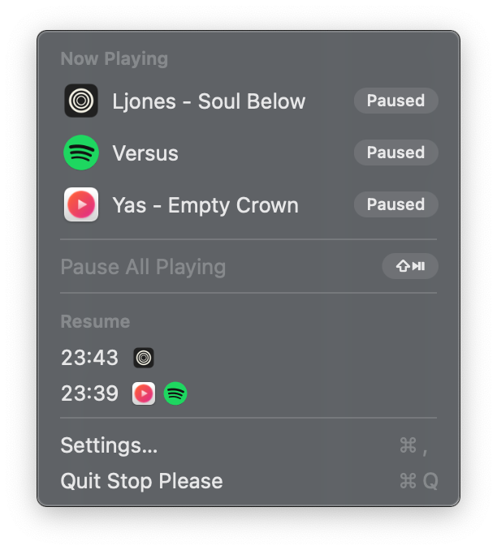
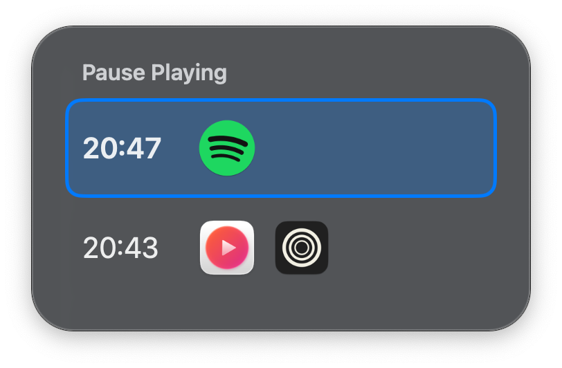
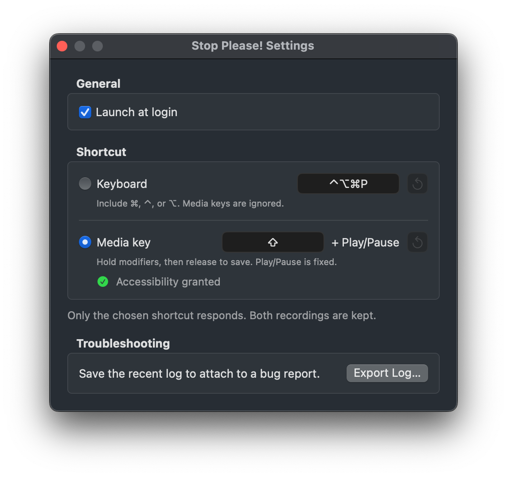
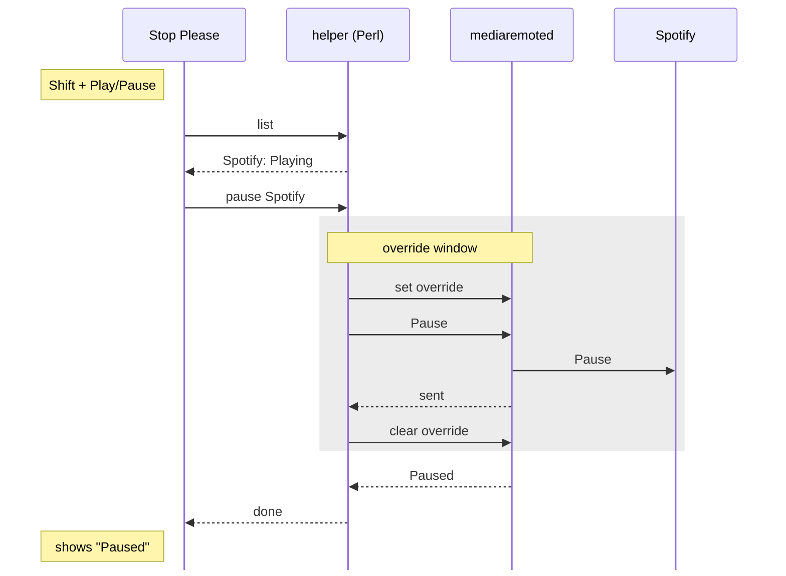

<p align="center">
  
</p>

<h1 align="center">Stop Please!</h1>

Stop Please is a **menu-bar utility for macOS 15 or later** that pauses **everything that is playing**, and later **resumes only what it paused**.

Ever tried pausing your music in Spotify or YouTube Music after hovering over a YouTube thumbnail, or after watching a YouTube video? Play/Pause no longer reaches your music, because Spotify or YouTube Music is no longer the macOS Now Playing app.

So I built Stop Please. With a single shortcut, **Shift + Play/Pause**, it pauses every app that is playing: watching a video while listening to music pauses both. The next press resumes exactly those apps. It works with any app that appears in Now Playing, with nothing to set up per app.

---

## Features

- Pauses every playing app with one shortcut and remembers them as a group
- Resumes that group with the next press, even if another app has since become the Now Playing app
- Keeps up to three groups; when there are several, a chooser picks which one to resume
- Lists every Now Playing source in the menu; click one to pause or play just that app
- Works with the apps as installed: no plugins, no per-app setup, nothing injected into them

---

## Installation

1. Download `StopPlease-<version>.dmg` (or the `.zip`) from [Releases](https://github.com/chengandre/stop-please/releases).
2. Open it and drag **Stop Please!** to **Applications**.
3. Open the app. It is not notarized, so macOS blocks the first launch: open **System Settings → Privacy & Security**, click **Open Anyway** next to the message about Stop Please, and confirm.

Stop Please lives in the menu bar and has no Dock icon. To build from source, see [DEVELOPMENT.md](DEVELOPMENT.md).

---

## Usage

### First launch

A setup window asks you to choose your shortcut:

- **Shift + Play/Pause**: needs Accessibility (see [Permissions](#permissions)). Until it is granted, ⌃⌥⌘P works instead.
- **Keyboard shortcut ⌃⌥⌘P**: no permission needed.

Closing the window chooses the keyboard shortcut. Either choice can be changed later in Settings.

### The shortcut

Each press looks at what is playing first:

| Situation | Press |
| --------- | ----- |
| Something is playing | Pauses every playing app and saves them as a new group |
| Nothing is playing, one group saved | Resumes that group |
| Nothing is playing, two or three groups saved | Opens the chooser |
| Nothing is playing, no groups saved | Plays the current Now Playing app, like the Play/Pause key |

Groups:

- At most three are kept, newest first. A fourth replaces the oldest.
- A resumed group is removed, and so is one whose apps have all quit or are already playing. A group that failed to resume is kept so you can try again.
- A group never changes after it is saved, and only apps still paused are resumed.
- Groups are kept in memory and are cleared when Stop Please quits.

### The menu



- **Now Playing** lists every source with its app icon, title, and state.
- **Pause All Playing** does the same as the shortcut when something is playing; the shortcut is shown on its right.
- **Resume** lists the saved groups by the time they were paused; click one to resume it.
- Clicking a Now Playing row pauses or plays only that app and never creates or changes a group.
- Hovering over a group shows each app with the title it was playing when paused.
- When something could not be paused or resumed, the reason appears under the groups.

### The chooser

Opens in the middle of the screen when there are several groups to resume.



- ↑/↓ or Tab/⇧Tab to move, Return or a click to resume
- Esc or a click outside to dismiss

### The confirmation

A small pill near the bottom of the screen shows **Paused** or **Resumed** with the affected apps' icons, then fades. An app that did not respond is dimmed with a "!" and its reason is in the menu.


### Settings

Open **Settings…** from the menu (⌘,) to choose between the two shortcuts and record either one:

- **Keyboard**: a letter, number, symbol, or F-key with at least one of ⌘, ⌃, or ⌥.
- **Media key**: Play/Pause is fixed; hold the modifiers you want and release them to save. Shift alone is allowed.

Only the chosen shortcut responds, and both recordings are kept.



---

## Permissions

The **keyboard shortcut needs no permission**, and neither does anything else in the app except the media-key shortcut.

**Shift + Play/Pause needs Accessibility.** Stop Please has to take the key before your player sees it; otherwise the player would also toggle. When it is chosen, macOS asks for the permission. While it is missing, the keyboard shortcut works instead and the menu shows **Accessibility Needed…**, which asks for the permission again or opens its page in System Settings. The switch back happens as soon as the permission is granted, without a relaunch.

No other permissions are requested: no Input Monitoring, no Automation, no screen or audio recording.

---

## Updating and uninstalling

To update, quit Stop Please and replace the app in **Applications** with the new one.

Builds are not signed with a Developer ID, so macOS treats each version as a new app and stops honoring its Accessibility permission. If you use Shift + Play/Pause, remove Stop Please from **System Settings → Privacy & Security → Accessibility** with **−**, then choose **Accessibility Needed…** in the menu to grant it again.

To uninstall, quit Stop Please, delete it from **Applications**, and remove it from the Accessibility list if it is there.

---

## How it works

Now Playing is managed by a system service, `mediaremoted`, through Apple's private MediaRemote framework. Since macOS 15.4, the service hides other apps' Now Playing information from ordinary apps. Processes with an Apple identity are exempt, so Stop Please runs a small helper inside the system Perl (`/usr/bin/perl`, signed by Apple as `com.apple.perl`) and talks to it over a pipe.

The helper:

1. **Lists** every Now Playing source with its app, process, state, and title.
2. **Targets** one app by briefly making it the system's Now Playing app (the "override"), sending an explicit Play or Pause, and clearing the override. When the target is already the Now Playing app, it sends the command directly. A command takes about 30 ms.
3. **Recognizes** a paused app later by its process ID and identity, and checks both in a fresh list before every command.

You will see a `perl` process in Activity Monitor while Stop Please runs; that is the helper.

For example, a pause while Spotify plays, after a YouTube preview became the Now Playing app, looks like this:



The helper waits until Spotify is the Now Playing app before sending, and skips the override entirely when it already is.

---

## Safety and recovery

Stop Please is intentionally non-invasive:

- nothing is injected into other apps
- no security settings are changed
- target apps are used as installed, with no plugins or settings
- the override is set only for your commands, never when the menu opens or sources are listed (plus once when the helper starts, to release one left behind)
- the helper refuses to send a command unless the intended app really became the Now Playing app

If the helper exits, Stop Please restarts it at once, and a new helper releases any override left behind.

If media keys or headphone buttons ever seem stuck on one app, quit and reopen Stop Please.

---

## Known limitations

- **The override is system-wide.** While a command is routed through it, any media key press or command from another app also reaches the targeted app. The window is a fraction of each command's roughly 30 ms, but not zero. The open-source project this technique comes from left out per-app commands for this reason.
- **Platform risk.** The route depends on the Apple-identity exemption and on Perl shipping with macOS. Apple has said scripting runtimes will eventually be removed, and any macOS update could close the route. When it stops working, the menu says so.
- **Only apps that appear in Now Playing.** Apps that play audio without publishing to Now Playing are not seen.
- **One source per app.** A browser is one source regardless of how many tabs play.
- **Apps with the same identity.** Some apps are signed with a generic identity; for example, several Electron apps can all appear as `Electron`. When two of them play at once, Stop Please refuses to control them rather than risk the wrong one.
- **A relaunched app is not resumed.** Groups remember the app's process, so an app that quit after being paused is skipped.
- **Groups are not saved** across quits.

---

## Project structure

```text
StopPlease/                       Swift menu-bar app
├── App/
│   ├── main.swift
│   └── AppDelegate.swift         startup and wiring
├── NowPlaying/
│   ├── HelperProtocol.swift      messages exchanged with the helper
│   ├── HelperClient.swift        starts, supervises, and restarts the helper
│   └── Coordinator.swift         saved groups, actions, and what the confirmation shows
├── Shortcuts/
│   ├── GlobalShortcut.swift      keyboard shortcut
│   ├── MediaKeyTap.swift         Shift + Play/Pause and the Accessibility check
│   └── ShortcutController.swift  which shortcut is chosen and active
├── UI/
│   ├── MenuBarController.swift   menu
│   ├── GroupChooser.swift        chooser panel
│   ├── ConfirmationPill.swift    confirmation pill
│   └── AppIconCache.swift        app icons for the menu, chooser, and pill
├── Windows/
│   ├── SettingsWindow.swift      Settings and both recorders
│   └── SetupWindow.swift         first-launch setup
├── Info.plist                    turns on the localized name (other keys are generated)
├── en.lproj/InfoPlist.strings    the localized name Finder shows: Stop Please!
└── Assets.xcassets/              menu-bar and app icons

NowPlayingPerlHelper/
├── perl_helper.m                 helper library: every MediaRemote call
└── perl_helper.pl                loads the library into /usr/bin/perl

tests/
├── perl_acceptance.py            acceptance tests against real players
└── helper_smoke.py               starts the bundled helper and lists sources

assets/                           icon source (icon.svg) and screenshots

project.yml                       XcodeGen project spec
Signing.xcconfig                  code signing (ad-hoc unless Local.xcconfig is present)
```

---

## Credits

- [mediaremote-adapter](https://github.com/ungive/mediaremote-adapter) by ungive, for the technique of reaching MediaRemote from the system Perl. Stop Please's helper is its own implementation, including the per-app commands.